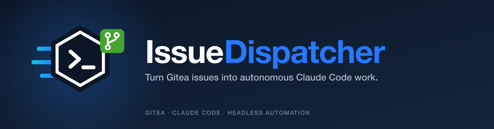

<p align="center">
  
</p>

# IssueDispatcher

> Turn Gitea issues into autonomous Claude Code work.

IssueDispatcher (repo and image: `claude-dispatcher`) lets
[Claude Code](https://docs.claude.com/en/docs/claude-code) work through a
[Gitea](https://about.gitea.com) issue backlog like a teammate. Assign an issue
to a bot user and the dispatcher:

1. runs headless Claude Code on the repo to implement it, on its own branch;
2. pushes the branch and opens a pull request (or a stack of them);
3. waits for CI, sends failures and review feedback back to Claude, and merges
   when CI is green;
4. collects questions and decisions it wants confirmed in one issue per ticket
   for a human;
5. closes the issue and picks up the next one.

It works on one issue per repo at a time, keeps Claude's usage limits and your
CI runners in mind, and recovers from restarts by reading state back from
Gitea.

> PRs merge **without human review** when CI passes. Only point this at repos
> whose CI you trust to catch mistakes, and read [Security](#security) first.

## How it works

```
                 ┌───────────────────────── IssueDispatcher ────────────────────────┐
 Gitea  ◀─ poll ─┤ engine: one slot per repo, labels as state, sessions in SQLite   │
 issues, PRs,    │   ├─ runner: claude -p (stream-json) in a per-repo git workspace │
 labels, CI      │   ├─ PR lifecycle: open, watch CI, fix rounds, merge, stacks     │
                 │   ├─ questions: one checklist issue per ticket for a human       │
                 │   └─ governors: usage limits, CI queue, session cap              │
                 └──────────────────────────────────────────────────────────────────┘
```

- **Labels are the state** (`claude:working`, `claude:in-review`,
  `claude:blocked`), so a lost database or a restart loses nothing: in-flight
  work resumes in the same Claude session.
- **Claude only commits.** The dispatcher pushes and talks to Gitea, so the
  Gitea token never enters Claude's environment.
- **Claude's final answer is a structured report** (validated JSON): branches
  to open as PRs, decisions it took on its own, and questions for a human.
- **Humans steer with Gitea itself:** assign or unassign, priority and
  model/effort labels, review comments, `/merge`, ticking and replying on questions issues.

More: [workflow](docs/workflow.md) · [configuration](docs/config.md) ·
[labels](docs/labels.md) · [deployment](docs/deploy.md) ·
[operations](docs/operations.md) · [brand](docs/brand.md)

## Requirements

- Gitea (developed against 1.27) and CI on each watched repo that reports commit
  statuses: Gitea Actions, or any CI that posts statuses to Gitea
- Claude Code credentials: a Claude subscription token (`claude setup-token`)
  or an Anthropic API key
- Docker (recommended) or Node 22.12+

## Set up Gitea

1. **Bot user**: create a regular (non-admin) user, e.g. `claude-bot`, and add
   it as a collaborator with **Write** access to each repo it should work on
   (Gitea only lets you assign issues to users with access). With `ORGS`, add
   it instead to an org team with Write access to all repositories.
2. **Token**: logged in as the bot, create an access token with
   `write:repository`, `write:issue` and `read:user`, plus `read:organization`
   if you use `ORGS`. Scopes can't be changed later, so a missing one means a
   new token. The token must belong to
   the bot so commits, comments and PRs are attributed to it.
3. **Branch protection** on the default branch: require status checks, require
   **0** approvals (the bot can't approve its own PRs, so any required approval
   blocks merging), and allow the bot to merge.

## Run it

```sh
cp stack.env.example stack.env   # Gitea URL, bot token, repos, Claude credentials
docker compose up -d --build
```

Then assign an issue to the bot. `docker compose logs -f dispatcher` shows
what it's doing; the [web dashboard](docs/dashboard.md) on port 8080 shows
health, work, runs, costs and live logs, and lets you tune the runtime config
and pause pickups. Until you log in with `DASHBOARD_TOKEN` it shows only a
landing page. `/status` gives the same overview as JSON
([operations](docs/operations.md)).

To try it without touching a real instance, `scripts/dev-gitea.sh up` starts a
throwaway local Gitea with a bot user and a demo repo, and runs the dispatcher
against it.

## Configuration

Everything is set by environment variables (optionally plus a YAML file for
routing rules); nothing about your instance is hard-coded. The essentials:

| Variable                                         | Purpose                            |
| ------------------------------------------------ | ---------------------------------- |
| `GITEA_URL`, `GITEA_TOKEN`, `BOT_USERNAME`       | The instance and the bot account   |
| `HUMAN_REVIEWER`                                 | Who gets questions and mentions    |
| `REPOS` / `ORGS`                                 | What to watch                      |
| `CLAUDE_CODE_OAUTH_TOKEN` or `ANTHROPIC_API_KEY` | Claude Code auth                   |
| `MAX_CONCURRENT_SESSIONS`, `CI_MAX_QUEUE`        | How much runs at once              |
| `CLAUDE_MODEL`, `CLAUDE_EFFORT`, `MODEL_LABELS`  | Default and per-issue model/effort |

See [docs/config.md](docs/config.md) for all options, including per-phase and
per-repo routing.

## Security

Claude runs project commands (tests, builds, git) **without approval prompts**,
so the container is the sandbox:

- Issue text, comments, review notes and CI logs are written by other people
  and are passed to Claude as untrusted data, but prompt injection can't be
  ruled out. Only let people you trust open or comment on issues in watched repos.
- Never mount the Docker socket into the container. Keep it on its own network
  with no credentials beyond the bot token and Claude's own.
- The bot account should not be an admin, and its token should only have the
  scopes above.
- The Gitea token is kept out of Claude's environment, process arguments,
  `.git/config` and logs.
- The dashboard and `/status` need `DASHBOARD_TOKEN` (locked when it's unset);
  logged-out visitors see only a landing page. A session can't change
  identity, paths, credentials or Claude's permission mode. Expose it beyond
  localhost only behind HTTPS.

Report vulnerabilities as described in [SECURITY.md](SECURITY.md).

## Development

```sh
corepack enable && pnpm install
pnpm lint && pnpm format:check && pnpm typecheck && pnpm test
cp .env.example .env && pnpm dev     # runs against the Gitea in .env
```

See [CONTRIBUTING.md](CONTRIBUTING.md).

## License

[MIT](LICENSE)
