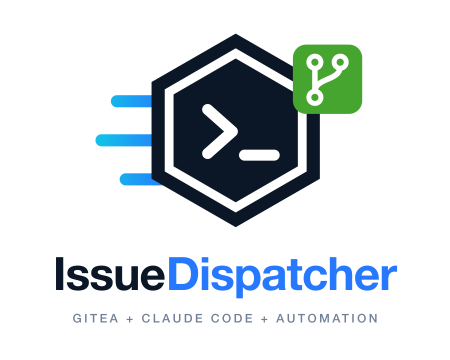

# Brand

<p align="center">
  
</p>

**IssueDispatcher** is the product name. Use it in prose, headings, page titles
and anything a person reads. `claude-dispatcher` stays as the repository,
package, container image and compose service name, and as the marker in the
issues it files (`<!-- claude-dispatcher:questions … -->`,
`<!-- claude-dispatcher:item … -->`), which state recovery parses, so it must
never change.

Tagline: **Turn Gitea issues into autonomous Claude Code work.**

## The mark

A hex badge holding a terminal prompt (Claude Code working in a shell), motion
lines on the left (dispatch), and a Git branch badge (the repository and its
PRs). Use the icon on its own for avatars, favicons and compact navigation;
the horizontal wordmark for headers and docs; the stacked logo for splash
screens, social profiles and centred layouts. Below 64px use the favicon cut,
which drops the motion lines and Git badge.

| Background | Wordmark                                             |
| ---------- | ---------------------------------------------------- |
| light      | `issuedispatcher-wordmark-dark.svg` (navy "Issue")   |
| dark       | `issuedispatcher-wordmark-light.svg` (white "Issue") |

The same `-dark`/`-light` rule applies to the stacked logo. The icon works on
both, since the hex carries its own navy fill.

## Colour

| Token         | Hex       | Use                                     |
| ------------- | --------- | --------------------------------------- |
| `--id-navy`   | `#0B1726` | backgrounds, hex fill, "Issue" on light |
| `--id-navy-2` | `#14263B` | gradient partner for navy               |
| `--id-blue`   | `#2678FF` | "Dispatcher", links, primary actions    |
| `--id-purple` | `#6A2BFF` | end of the motion gradient              |
| `--id-cyan`   | `#13BFE8` | start of the motion gradient; active    |
| `--id-green`  | `#45A52F` | Git badge, success                      |
| `--id-orange` | `#FF5A36` | sparing accent: warnings, highlights    |
| `--id-muted`  | `#708096` | secondary text                          |
| `--id-light`  | `#F5F8FC` | light backgrounds                       |

The tokens are in `assets/brand/web/brand-variables.css`.

## Type

Inter, ExtraBold (800) for the wordmark and headings, Regular/Medium for body
text; JetBrains Mono (or any monospace) for commands and technical labels.

## Assets

Everything is under [`assets/brand/`](../assets/brand) and is built from one
source, so don't edit the outputs by hand:

| Path       | Contents                                                                 |
| ---------- | ------------------------------------------------------------------------ |
| `src/`     | `mark.svg.part`, the mark in a 512×512 space; the one file to change     |
| `svg/`     | icon, icon without Git badge, wordmark and stacked logo (dark and light) |
| `png/`     | transparent exports: icon 64–512px, wordmarks 1500px, stacked 900px      |
| `favicon/` | `favicon.svg`/`.ico`, 16/32/48px, Apple touch 180px, Android 192/512px   |
| `web/`     | README header (dark, light), hero (2400×900), CSS tokens, web manifest   |
| `social/`  | Open Graph image (1200×630)                                              |

To rebuild after changing the mark or a layout:

```sh
brew install librsvg imagemagick   # plus the Inter font, for raster text
python3 assets/brand/build.py
```

The kit started from a generated concept. The build fixes two defects in the
originals: the motion-line gradient used bounding-box units on zero-height
lines, so they never rendered, and the Git badge glyph was malformed.

## On a web page

```html
<link rel="icon" href="/favicon.svg" type="image/svg+xml" />
<link rel="icon" href="/favicon.ico" sizes="48x48" />
<link rel="apple-touch-icon" href="/apple-touch-icon.png" />
<link rel="manifest" href="/site.webmanifest" />
<meta property="og:image" content="/og-image.png" />
<meta name="twitter:card" content="summary_large_image" />
```
